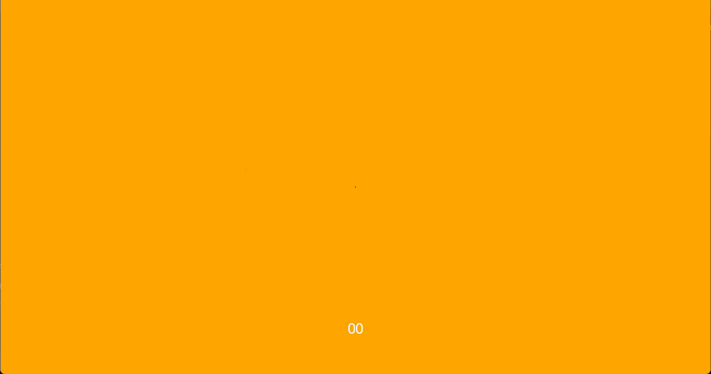

# Mediterranean Restaurant Hero Prototype

A small frontend microproject exploring a clone of the Realevate website's
hero section and image-reveal animation, reimagined as a prototype for a
Mediterranean-style restaurant website. The page combines layered photography,
animated typography, and a scrolling marquee to create a cinematic first
impression.

This is an independent visual prototype and is not affiliated with Realevate.

## Preview



## Built with

- Vite
- GSAP
- Lenis
- Tailwind CSS

## Run locally

1. Install dependencies:

   ```bash
   npm install
   ```

2. Start the development server:

   ```bash
   npm run dev
   ```

3. Open the local URL shown in the terminal (usually http://localhost:5173).

## Build for production

```bash
npm run build
```
